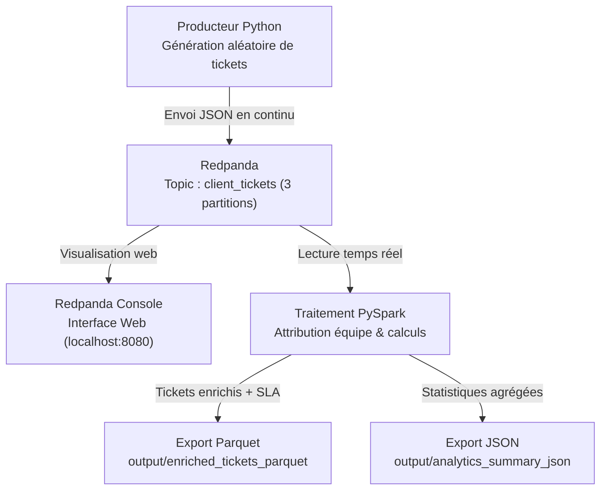

# POC — Pipeline Temps Réel de Gestion des Tickets Clients (InduTech)

Ce dépôt contient le Proof of Concept (POC) d'un pipeline Data Engineering temps réel conçu pour **InduTech**. Il permet d'ingérer, d'enrichir et d'analyser en continu les tickets clients à l'aide de **Redpanda**, **Python**, **PySpark** et **Docker Compose**.

---

## Architecture du Pipeline ETL (Diagramme Mermaid)



---

## Démonstration Vidéo

* **Présentation et démonstration du pipeline ETL :** [Lien vidéo](REMPLACER_PAR_VOTRE_LIEN_VIDEO)

*(Cette courte vidéo présente l'architecture du projet, le démarrage complet via `docker compose up -d`, l'arrivée en direct des tickets dans l'interface web de Redpanda et la génération automatique des fichiers Parquet et JSON par PySpark.)*

---

## Structure du Projet

```text
indutech-tickets-poc/
├── docker-compose.yml              # Orchestration complète (Redpanda, Console, Producer, Spark)
├── README.md                       # Documentation du projet et diagramme Mermaid
├── redpanda/
│   └── Dockerfile                  # Image Docker de Redpanda
├── producer/
│   ├── Dockerfile                  # Image Docker du générateur de tickets
│   ├── producer.py                 # Script Python générant les tickets clients aléatoires
│   └── requirements.txt            # Dépendance : kafka-python-ng
├── spark/
│   ├── Dockerfile                  # Image Docker Apache Spark 3.5.3 + connecteur Kafka
│   ├── consumer_spark.py           # Pipeline PySpark de traitement en temps réel
│   └── requirements.txt            # Dépendance : pyspark==3.5.3
└── output/                         # Répertoire monté en volume contenant les exports Parquet & JSON
```

---

## Prérequis & Lancement Rapide (Docker Compose)

### Prérequis

* **Docker Desktop** (avec moteur Linux / WSL2 actif) et **Docker Compose v2+**.

### 1. Démarrer l'ensemble du pipeline en une commande

Depuis la racine du dossier `indutech-tickets-poc` :

```bash
docker compose up --build -d
```

Cette commande :

1. Construit les 3 images Docker (`redpanda`, `ticket-producer`, `spark-processor`).
2. Démarre **Redpanda** et attend qu'il soit opérationnel (`healthcheck`).
3. Crée automatiquement le topic **`client_tickets`** (3 partitions) via le conteneur `redpanda-init`.
4. Lance **Redpanda Console** sur [http://localhost:8080](http://localhost:8080).
5. Démarre l'envoi continu de tickets par `indutech-producer` et leur analyse temps réel par `indutech-spark`.

### 2. Vérifier le fonctionnement en direct

* **Contrôler l'état des conteneurs :**
  ```bash
  docker compose ps
  ```
* **Suivre les journaux du producteur et de PySpark :**
  ```bash
  docker compose logs --tail 6 ticket-producer spark-processor
  ```
* **Inspecter les topics et messages dans l'interface web :**
  Ouvrez [http://localhost:8080](http://localhost:8080) > **Topics** > **`client_tickets`** > **Messages**.
* **Consulter les résultats exportés :**
  * Données détaillées enrichies : `output/enriched_tickets_parquet/*.snappy.parquet`
  * Synthèse analytique agrégée : `output/analytics_summary_json/*.json`

### 3. Arrêter la stack proprement

```bash
docker compose down
```

---

## Modèle de Données & Règles Métier

### Format des messages entrants (`client_tickets`)

Chaque ticket généré en JSON contient les 6 attributs suivants :

* `ticket_id` : identifiant unique du ticket (ex. `TKT-70103BB1`)
* `client_id` : identifiant du client (ex. `CLI-1014`)
* `created_at` : horodatage de création (`YYYY-MM-DD HH:MM:SS`)
* `request` : description textuelle de la demande
* `request_type` : catégorie de la demande
* `priority` : niveau d'urgence (`Basse`, `Moyenne`, `Haute`, `Critique`)

### Enrichissements et agrégations PySpark

| Type de demande (`request_type`) | Équipe assignée automatiquement (`assigned_team`) |
| :--------------------------------- | :---------------------------------------------------- |
| `Incident technique`             | Support Niveau 2 - Infrastructure                     |
| `Maintenance capteur IoT`        | Équipe IoT & Terrain                                 |
| `Facturation & Contrat`          | Service Administration des Ventes                     |
| `Accès & Identifiants`          | Équipe IAM & Sécurité AD                           |
| `Demande d'information`          | Support Niveau 1 - Accueil                            |

* **SLA cible (`sla_target_hours`) :** `2h` (Critique), `4h` (Haute), `24h` (Moyenne), `48h` (Basse).
* **Performance & Résilience Spark :** partitions de shuffle ajustées (`spark.sql.shuffle.partitions=4`), arrêt gracieux (`stopGracefullyOnShutdown=true`), filtrage des messages JSON invalides et gestion des *checkpoints* (`output/_checkpoints/`).
